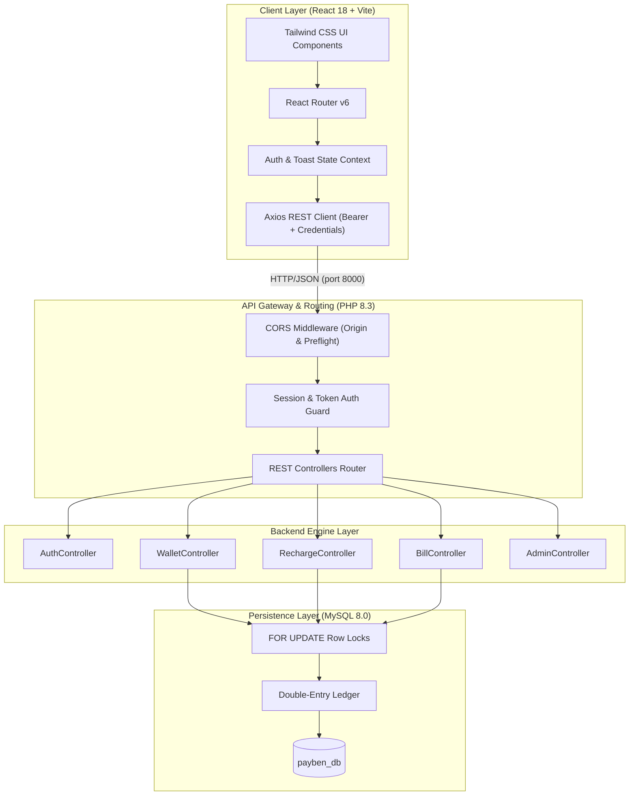

<div align="center">

# ⚡ PayBen

### **Modern Smart UPI & Multi-Utility Payment Ecosystem**

*A production-grade, full-stack fintech platform built with a decoupled architecture — powered by a high-performance **React.js SPA** frontend and a robust **PHP 8 REST API** backend with **MySQL**.*

<br/>

[](https://react.dev/)
[](https://vitejs.dev/)
[](https://tailwindcss.com/)
[](https://www.php.net/)
[](https://www.mysql.com/)
[](LICENSE)

<br/>

> 🛡️ **Sandbox Notice**: All financial transactions, UPI transfers, mobile recharges, and utility settlements run in a simulated fintech environment with zero real money risk.

</div>

---

## 🌟 Key Highlights

<table>
  <tr>
    <td width="50%">
      <h3>⚡ Smart UPI Dashboard</h3>
      <ul>
        <li>Google Pay-inspired frictionless interface</li>
        <li>Personalized <code>@payben</code> UPI ID handle</li>
        <li>One-tap quick actions: Send, Request, Top-up, QR</li>
        <li>Recent network contacts carousel for instant P2P payments</li>
      </ul>
    </td>
    <td width="50%">
      <h3>🎁 Interactive Rewards Engine</h3>
      <ul>
        <li>Mystery scratch cards unlocked with every transaction</li>
        <li>Dynamic canvas confetti celebration</li>
        <li>Random cashback rewards (₹5 – ₹50) credited instantly</li>
        <li>Zero fees, instant double-entry wallet reflection</li>
      </ul>
    </td>
  </tr>
  <tr>
    <td width="50%">
      <h3>📱 Telecom & DTH Recharges</h3>
      <ul>
        <li>Prepaid mobile recharge for Jio, Airtel, Vi, and BSNL</li>
        <li>Tabbed tariff browser (Unlimited, Daily Data, Top-ups)</li>
        <li>DTH subscription top-ups for Tata Play, Sun Direct, D2H</li>
        <li>Real-time subscriber validation & instant ledger deduction</li>
      </ul>
    </td>
    <td width="50%">
      <h3>💡 Multi-Utility Bill Payments</h3>
      <ul>
        <li>Electricity bill fetch & settlement across state boards</li>
        <li>Municipal corporation water supply bill lookup</li>
        <li>Piped natural gas & cylinder booking payments</li>
        <li>Downloadable and printable digital transaction receipts</li>
      </ul>
    </td>
  </tr>
</table>

---

## 🏗️ System Architecture

PayBen is architected around a strict decoupled design pattern: **Client-Side Rendering (CSR)** communicating through a **JSON REST API** layer with **Atomic Double-Entry Bookkeeping**.



---

## 📂 Repository Structure

```
PayBen/
│
├── frontend/                     # ⚛️ React 18 Single Page Application
│   ├── public/                   # Static icons & brand assets
│   ├── src/
│   │   ├── assets/               # CSS styles & design tokens
│   │   ├── components/           # Reusable UI widgets
│   │   │   ├── common/           # Navbar, Sidebar, Badges
│   │   │   └── modals/           # SendMoney, AddMoney, QrModal, ScratchCard
│   │   ├── context/              # Global state (AuthContext, ToastContext)
│   │   ├── layouts/              # MainLayout & AdminLayout shells
│   │   ├── pages/
│   │   │   ├── auth/             # Login & Register views
│   │   │   ├── admin/            # Analytics, Users, and Transactions
│   │   │   ├── dashboard/        # Main UPI & Wallet Dashboard
│   │   │   ├── bills/            # Electricity, Water, and Gas bill pay
│   │   │   ├── recharge/         # Mobile & DTH recharge flows
│   │   │   ├── wallet/           # Digital wallet & ledger audit trail
│   │   │   ├── transactions/     # Statements & receipt modals
│   │   │   └── profile/          # User profile settings
│   │   ├── routes/               # AppRoutes with ProtectedRoute guards
│   │   ├── services/             # Modular Axios API service layer
│   │   ├── App.jsx               # Root App component
│   │   └── main.jsx              # Vite entry point
│   ├── .env                      # Frontend environment config
│   ├── package.json              # NPM dependencies
│   ├── tailwind.config.js        # Custom fintech color palette
│   └── vite.config.js            # Vite build & reverse proxy
│
├── backend/                      # 🐘 Layered PHP REST API Backend
│   ├── api/                      # Public REST JSON endpoints
│   │   ├── admin/                # Telemetry, user management & audit logs
│   │   ├── auth/                 # Login, register, me, logout endpoints
│   │   ├── bills/                # Utility bill lookup & payment APIs
│   │   ├── recharge/             # Operators, plans, and recharge APIs
│   │   ├── transactions/         # Statements & dashboard summary APIs
│   │   └── wallet/               # Balance, transfer, top-up, scratch card
│   ├── config/                   # Config loader & singleton PDO database
│   ├── controllers/              # Business logic controllers
│   ├── models/                   # Database access objects (User, Wallet...)
│   ├── middleware/               # CORS preflight & auth verification
│   ├── database/                 # Schema & seeds (payben_db.sql)
│   ├── index.php                 # Healthcheck & API status endpoint
│   └── .env                      # Database credentials & CORS origins
│
├── docs/                         # Specifications & setup guides
├── .gitignore                    # Production git exclusions
├── LICENSE                       # MIT License
└── README.md
```

---

## ⚡ Quick Start

### 1. Prerequisites
- **Node.js** (v18+) and **npm**
- **PHP** (v8.0+) with `pdo_mysql` extension enabled
- **MySQL** (v5.7+ or v8.0+)

### 2. Database Initialization
Import the database schema and sample seed records into MySQL:

```bash
# Log in to MySQL and import schema
mysql -u root -p payben_db < backend/database/payben_db.sql
```

Verify your credentials in `backend/.env`:
```env
DB_HOST=127.0.0.1
DB_PORT=3307          # Or 3306 for standard MySQL
DB_NAME=payben_db
DB_USER=root
DB_PASS=
```

### 3. Start the Backend API Server
```bash
cd backend
php -S 127.0.0.1:8000
```
> 🩺 Test API healthcheck: [`http://127.0.0.1:8000/index.php`](http://127.0.0.1:8000/index.php)

### 4. Start the Frontend React Client
```bash
cd frontend
npm install
npm run dev
```
> 🚀 Open **[`http://localhost:5173`](http://localhost:5173)** in your browser!

---

## 🔑 Test Credentials

| Account | Email / Username | Password | Role | Wallet Balance |
| :--- | :--- | :--- | :--- | :--- |
| **Rahul Sharma** | `user1@test.com` | `password123` | Customer | **₹5,000.00** |
| **Priya Patel** | `user2@test.com` | `password123` | Customer | **₹5,000.00** |
| **Administrator** | `admin@payben.com` | `admin123` | Admin | Staff Portal |

*🎁 Bonus: Every new registration receives an instant ₹500 welcome credit automatically!*

---

## 🔌 REST API Documentation

All API responses follow the uniform JSON envelope:
```json
{
  "success": true,
  "message": "Operation completed successfully.",
  "data": { ... }
}
```

### Core API Routes

| Domain | Method | Endpoint | Description |
| :--- | :---: | :--- | :--- |
| **Auth** | `POST` | `/api/auth/login.php` | Authenticates user & issues session token |
| **Auth** | `POST` | `/api/auth/register.php` | Creates user account & funds ₹500 bonus |
| **Auth** | `GET` | `/api/auth/me.php` | Fetches active session profile & balance |
| **Auth** | `POST` | `/api/auth/logout.php` | Terminates active session |
| **Wallet** | `GET` | `/api/wallet/balance.php` | Retrieves current balance & UPI ID |
| **Wallet** | `POST` | `/api/wallet/add-money.php` | Simulates instant wallet top-up |
| **Wallet** | `POST` | `/api/wallet/transfer.php` | Executes atomic P2P transfer |
| **Wallet** | `POST` | `/api/wallet/scratch-card.php` | Awards random cashback (₹5–₹50) |
| **Wallet** | `GET` | `/api/wallet/history.php` | Paginated double-entry ledger |
| **Recharge** | `GET` | `/api/recharge/operators.php` | Lists active telecom / DTH providers |
| **Recharge** | `GET` | `/api/recharge/plans.php?operator_id=X` | Lists tariff plans for operator |
| **Recharge** | `POST` | `/api/recharge/mobile.php` | Deducts wallet & recharges phone |
| **Recharge** | `POST` | `/api/recharge/dth.php` | Deducts wallet & recharges DTH |
| **Bills** | `GET` | `/api/bills/{type}.php?action=fetch` | Verifies consumer number & fetches bill |
| **Bills** | `POST` | `/api/bills/{type}.php` | Settles electricity, water, or gas bill |
| **Transactions** | `GET` | `/api/transactions/dashboard.php` | Recent telemetry, stats & contacts |
| **Transactions** | `GET` | `/api/transactions/list.php` | Filterable statements log |
| **Transactions** | `GET` | `/api/transactions/details.php?id=X` | Single transaction receipt details |
| **Admin** | `POST` | `/api/admin/login.php` | Administrator authentication |
| **Admin** | `GET` | `/api/admin/dashboard.php` | Platform volume & reserve metrics |
| **Admin** | `GET` | `/api/admin/users.php` | User directory with status toggling |
| **Admin** | `GET` | `/api/admin/transactions.php` | System-wide transaction audit log |

---

## 🔒 Security Architecture

```
+-------------------------------------------------------------------+
|                       PayBen Security Model                       |
+-------------------------------------------------------------------+
| [CORS Guard]        Explicit origin whitelist (localhost:5173)     |
| [Password Hashing]  Bcrypt with dynamic salt (cost factor: 10)     |
| [SQL Injection]     100% Prepared Statements (PDO emulation OFF)  |
| [Concurrency Lock]  SELECT ... FOR UPDATE on all wallet debits    |
| [Session Defense]   HttpOnly, SameSite=Lax, ID regeneration       |
| [Double Entry]      Every debit is mirrored by a verified credit  |
+-------------------------------------------------------------------+
```

---

## 🛠️ Built With

- **[React 18](https://react.dev/)** — Modern component-based view library
- **[Vite](https://vitejs.dev/)** — Lightning-fast next-generation frontend tooling
- **[Tailwind CSS](https://tailwindcss.com/)** — Utility-first CSS framework with custom design tokens
- **[Lucide React](https://lucide.dev/)** — Beautiful & consistent iconography
- **[Axios](https://axios-http.com/)** — Promise-based HTTP client for browser & node
- **[Canvas Confetti](https://www.npmjs.com/package/canvas-confetti)** — Lightweight celebratory particle engine
- **[PHP 8.3](https://www.php.net/)** — Modern server-side scripting runtime
- **[MySQL 8.0](https://www.mysql.com/)** — Relational database management system with InnoDB transactions

---

## 📄 License

This project is licensed under the **MIT License** — see the [LICENSE](LICENSE) file for details.

<div align="center">
  <sub>Built with ❤️ by <a href="https://github.com/AbhijatPatel">Abhijat Patel</a> • PayBen Fintech Platform © 2026</sub>
</div>
