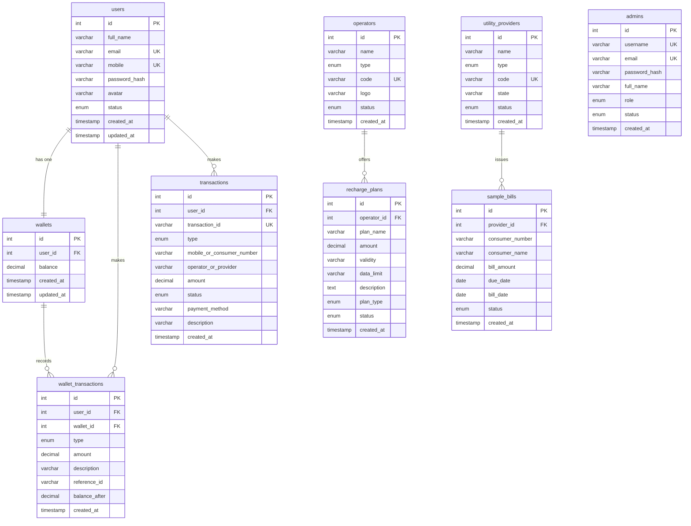

# PayBen Database Design

## Overview

The PayBen database (`payben_db`) uses **MySQL InnoDB** with `utf8mb4` charset. All monetary values use `DECIMAL` for precision, never `FLOAT`.

---

## Entity Relationship Diagram



---

## Table Reference

### 1. `users`
Core user accounts. One-to-one with `wallets`.

| Column        | Type            | Constraints          | Description            |
|---------------|-----------------|----------------------|------------------------|
| id            | INT UNSIGNED    | PK, AUTO_INCREMENT   | Primary key            |
| full_name     | VARCHAR(100)    | NOT NULL             | Full legal name        |
| email         | VARCHAR(100)    | NOT NULL, UNIQUE     | Login email            |
| mobile        | VARCHAR(15)     | NOT NULL, UNIQUE     | 10-digit mobile number |
| password_hash | VARCHAR(255)    | NOT NULL             | bcrypt hash            |
| avatar        | VARCHAR(255)    | NULL                 | Profile image path     |
| status        | ENUM            | DEFAULT 'active'     | active / inactive      |
| created_at    | TIMESTAMP       | DEFAULT NOW()        | Registration date      |
| updated_at    | TIMESTAMP       | ON UPDATE NOW()      | Last modification      |

**Indexes:** `uk_users_email`, `uk_users_mobile`, `idx_users_status`, `idx_users_created_at`

---

### 2. `admins`
Administrator accounts with role-based access control.

| Column        | Type         | Constraints      | Description               |
|---------------|--------------|------------------|---------------------------|
| id            | INT UNSIGNED | PK               | Primary key               |
| username      | VARCHAR(50)  | UNIQUE           | Login username            |
| email         | VARCHAR(100) | UNIQUE           | Admin email               |
| password_hash | VARCHAR(255) | NOT NULL         | bcrypt hash               |
| full_name     | VARCHAR(100) | NOT NULL         | Display name              |
| role          | ENUM         | DEFAULT 'admin'  | super_admin / admin       |
| status        | ENUM         | DEFAULT 'active' | active / inactive         |

---

### 3. `wallets`
One-to-one with `users`. Stores current balance.

| Column     | Type          | Constraints      | Description            |
|------------|---------------|------------------|------------------------|
| id         | INT UNSIGNED  | PK               | Primary key            |
| user_id    | INT UNSIGNED  | FK→users, UNIQUE | Owning user            |
| balance    | DECIMAL(12,2) | DEFAULT 0.00     | Current balance in INR |
| created_at | TIMESTAMP     | DEFAULT NOW()    | Creation time          |
| updated_at | TIMESTAMP     | ON UPDATE NOW()  | Last balance change    |

---

### 4. `wallet_transactions`
Double-entry ledger. Every balance change generates one record here.

| Column        | Type          | Description                          |
|---------------|---------------|--------------------------------------|
| id            | INT UNSIGNED  | Primary key                          |
| user_id       | INT UNSIGNED  | FK → users                           |
| wallet_id     | INT UNSIGNED  | FK → wallets                         |
| type          | ENUM          | credit / debit                       |
| amount        | DECIMAL(12,2) | Positive amount of movement          |
| description   | VARCHAR(255)  | Human-readable label                 |
| reference_id  | VARCHAR(50)   | Links to transaction_id              |
| balance_after | DECIMAL(12,2) | Wallet balance after this entry      |
| created_at    | TIMESTAMP     | When the movement occurred           |

---

### 5. `operators`
Mobile and DTH service providers.

| Column  | Type        | Description                 |
|---------|-------------|-----------------------------|
| id      | INT UNSIGNED| Primary key                 |
| name    | VARCHAR(100)| Operator display name       |
| type    | ENUM        | mobile / dth                |
| code    | VARCHAR(20) | Unique short code (e.g. JIO)|
| logo    | VARCHAR(255)| Path to logo image          |
| status  | ENUM        | active / inactive           |

**Sample Data:** Jio, Airtel, Vi, BSNL (mobile) + Tata Play, Airtel DTH, Dish TV, Sun Direct (dth)

---

### 6. `recharge_plans`
Tariff plans per operator. FK → `operators`.

| Column      | Type          | Description                    |
|-------------|---------------|--------------------------------|
| id          | INT UNSIGNED  | Primary key                    |
| operator_id | INT UNSIGNED  | FK → operators                 |
| plan_name   | VARCHAR(100)  | Plan display name              |
| amount      | DECIMAL(10,2) | Plan price in INR              |
| validity    | VARCHAR(50)   | e.g. "28 Days"                 |
| data_limit  | VARCHAR(50)   | e.g. "1.5 GB/Day" or "N/A"    |
| description | TEXT          | Full plan details              |
| plan_type   | ENUM          | prepaid / postpaid             |
| status      | ENUM          | active / inactive              |

**Sample Data:** 18 plans across all operators (₹149 to ₹999)

---

### 7. `utility_providers`
Electricity boards, water boards, gas companies.

| Column  | Type         | Description              |
|---------|--------------|--------------------------|
| id      | INT UNSIGNED | Primary key              |
| name    | VARCHAR(100) | Full provider name       |
| type    | ENUM         | electricity / water / gas|
| code    | VARCHAR(50)  | Unique short code        |
| state   | VARCHAR(100) | State of operation       |
| status  | ENUM         | active / inactive        |

**Sample Data:** 4 electricity, 3 water, 3 gas providers across Maharashtra, Delhi, Karnataka, Gujarat

---

### 8. `sample_bills`
Simulated consumer bills for demo bill-fetch-and-pay flows.

| Column          | Type          | Description                      |
|-----------------|---------------|----------------------------------|
| id              | INT UNSIGNED  | Primary key                      |
| provider_id     | INT UNSIGNED  | FK → utility_providers           |
| consumer_number | VARCHAR(20)   | Consumer account number          |
| consumer_name   | VARCHAR(100)  | Consumer name                    |
| bill_amount     | DECIMAL(10,2) | Bill amount in INR               |
| due_date        | DATE          | Payment due date                 |
| bill_date       | DATE          | Bill generation date             |
| status          | ENUM          | unpaid / paid                    |

**Sample Data:** 7 sample bills with varied amounts and statuses

---

### 9. `transactions`
Central unified log for all financial activities.

| Column                     | Type          | Description                      |
|----------------------------|---------------|----------------------------------|
| id                         | INT UNSIGNED  | Primary key                      |
| user_id                    | INT UNSIGNED  | FK → users                       |
| transaction_id             | VARCHAR(20)   | Unique ID (e.g. MR20261110ABCD)  |
| type                       | ENUM          | mobile_recharge / dth_recharge / electricity / water / gas / wallet_topup |
| mobile_or_consumer_number  | VARCHAR(50)   | Target phone or consumer number  |
| operator_or_provider       | VARCHAR(100)  | Operator / provider name         |
| amount                     | DECIMAL(10,2) | Transaction amount               |
| status                     | ENUM          | SUCCESS / PENDING / FAILED       |
| payment_method             | VARCHAR(50)   | "Wallet" for all                 |
| description                | VARCHAR(255)  | Human-readable note              |
| created_at                 | TIMESTAMP     | When transaction occurred        |

**Indexes:** `uk_transactions_tx_id`, `idx_transactions_user_id`, `idx_transactions_type`, `idx_transactions_status`, `idx_transactions_created_at`

---

## Key Relationships

```
users (1) ──────── (1) wallets
users (1) ────── (*) wallet_transactions
users (1) ────── (*) transactions
wallets (1) ────── (*) wallet_transactions
operators (1) ────── (*) recharge_plans
utility_providers (1) ────── (*) sample_bills
```

All foreign keys use `ON DELETE CASCADE ON UPDATE CASCADE`.

---

## Data Flow — Mobile Recharge

```
User clicks "Recharge"
        ↓
Server validates: mobile number format, operator exists
        ↓
BEGIN TRANSACTION
        ↓
SELECT balance FROM wallets WHERE user_id=? FOR UPDATE   ← row lock
        ↓
Check balance >= amount  → ROLLBACK if insufficient
        ↓
UPDATE wallets SET balance = balance - amount
        ↓
INSERT INTO wallet_transactions (type='debit', ...)
        ↓
INSERT INTO transactions (status='SUCCESS', transaction_id=generateTransactionID('MR'))
        ↓
COMMIT
        ↓
Return transaction receipt JSON
```

---

## Transaction ID Format

Generated by `generateTransactionID($prefix)` in `config/config.php`:

```
PREFIX + YYYYMMDD + RANDOM_6_CHARS_UPPERCASE
```

| Prefix | Transaction Type   |
|--------|--------------------|
| MR     | Mobile Recharge    |
| DT     | DTH Recharge       |
| EB     | Electricity Bill   |
| WB     | Water Bill         |
| GB     | Gas Bill           |
| WT     | Wallet Top-up      |

**Example:** `MR20261110A3F2B1`

